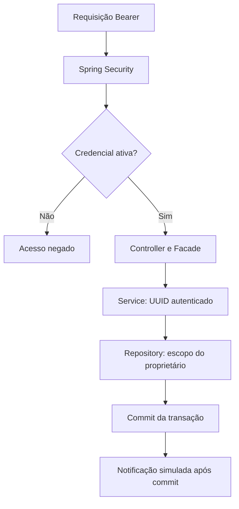

# Arquitetura e padrões

## Fronteira de autenticação

O Spring Security autentica requisições com `Authorization: Bearer <token>` em modo stateless. O token é opaco, gerado com 32 bytes criptograficamente aleatórios e codificado em Base64 URL-safe sem padding. O banco guarda seu hash SHA-256, não o segredo original. A aplicação não usa sessão HTTP para conceder acesso.

`auth_principals` mantém a identidade estável por UUID, `username` de até 64 caracteres, papel `USER` ou `ADMIN`, estado ativo, hash de token e data de criação. A autenticação consulta o hash e o estado persistido a cada requisição. Rotacionar uma credencial preserva o UUID e a propriedade das transações; revogar uma conta torna-a inativa e remove o hash utilizável.

## Fluxo de transações

O serviço define o proprietário ao criar a transação. O cliente não escolhe o UUID de outro principal. Listagem e busca por identificador incluem o proprietário autenticado na consulta; conhecer o ID de outra transação não concede acesso. O mesmo escopo vale para administradores.

| Padrão | Papel e motivo |
|---|---|
| Facade | oferece uma entrada simples para o fluxo de cadastro |
| Strategy | isola os canais de notificação e permite novas implementações |
| Factory | seleciona a Strategy sem condicionais no consumidor |
| Observer | desacopla persistência e notificação por evento de domínio |
| Repository | abstrai armazenamento e consultas JPA por proprietário |

A notificação é disparada `AFTER_COMMIT`: uma transação que sofreu rollback não gera notificação. Os adapters atuais continuam simulados por log; seu conteúdo e sua política de retenção não são modificados nesta implementação.

## Administração separada dos dados financeiros

Os endpoints `/admin/principals` exigem `ADMIN`. Permitem provisionar identidades, listar resumos sem credenciais, rotacionar tokens e revogar acesso. A credencial original é devolvida somente na criação ou rotação. Rotação reativa a conta e invalida o token anterior.

O papel administrativo não fornece uma listagem global de transações nem reatribuição de proprietários. A revogação do próprio chamador é bloqueada, assim como a remoção do último administrador ativo com credencial utilizável. Para reativar uma conta revogada, outro administrador deve executar a rotação.

## Inicialização e migrações

O primeiro administrador exige `APP_BOOTSTRAP_ADMIN_TOKEN` forte e sem valor padrão. `APP_BOOTSTRAP_ADMIN_USERNAME` permite escolher o nome inicial; seu padrão é `bootstrap-admin`. O bootstrap cria uma identidade somente na primeira inicialização de um banco sem principais. Ele não redefine a credencial de uma identidade existente.

A inicialização falha se o banco novo não receber um token válido ou se uma base existente não possuir administrador ativo com credencial. O console H2 está desativado. Flyway aplica `V1` e `V2`; Hibernate valida o esquema, sem tentar atualizá-lo. Baseline automático está desativado. O padrão H2 em memória continua efêmero; uma URL de banco persistente deve ser configurada para manter principais entre reinicializações.

Transações legadas podem conservar proprietário nulo para permitir a evolução do esquema sem inventar titularidade. Essas linhas ficam em quarentena: as consultas da API só retornam registros vinculados ao principal autenticado. A existência de uma conta administrativa não autoriza adotar todos os registros anteriores.

O operador deve revisar uma base legada e seu backup antes de um baseline manual explícito na versão `1`. Consulte [o procedimento de operação](ACCESS_CONTROL.md).

## Limites deste incremento

Não há concessão de propriedade por e-mail, CPF ou nome de exibição. Também não há autorização compartilhada por organização, leitura financeira global para suporte ou autoatendimento para recuperação de token.

Este incremento não implementa política de privacidade, avisos de finalidade, registro de aceite, pedidos de acesso, exportação integral por titular, eliminação/anonimização ou inventário de operadores. Identidade autenticada e isolamento dos registros são controles de acesso; não substituem essas rotinas.
